<picture>
  <source media="(prefers-color-scheme: dark)" srcset="assets/hero-dark.svg">
  
</picture>

  <a href="https://instagram.com/puchiideev"><picture>
  <source media="(prefers-color-scheme: dark)" srcset="assets/button-instagram-dark.svg">
  
</picture></a>
  <a href="https://twitter.com/puchiiidev"><picture>
  <source media="(prefers-color-scheme: dark)" srcset="assets/button-twitter-dark.svg">
  
</picture></a>

<picture>
  <source media="(prefers-color-scheme: dark)" srcset="assets/heading-about-dark.svg">
  
</picture>

<picture>
  <source media="(prefers-color-scheme: dark)" srcset="assets/about-dark.svg">
  
</picture>

<picture>
  <source media="(prefers-color-scheme: dark)" srcset="assets/heading-stack-dark.svg">
  
</picture>

<picture>
  <source media="(prefers-color-scheme: dark)" srcset="assets/stack-dark.svg">
  
</picture>

<picture>
  <source media="(prefers-color-scheme: dark)" srcset="assets/heading-badges-dark.svg">
  
</picture>

<picture>
  <source media="(prefers-color-scheme: dark)" srcset="assets/heading-connect-dark.svg">
  
</picture>

<picture>
  <source media="(prefers-color-scheme: dark)" srcset="assets/connect-dark.svg">
  
</picture>

  <a href="https://instagram.com/puchiideev"><picture>
  <source media="(prefers-color-scheme: dark)" srcset="assets/button-instagram-dark.svg">
  
</picture></a>
  <a href="https://twitter.com/puchiiidev"><picture>
  <source media="(prefers-color-scheme: dark)" srcset="assets/button-twitter-dark.svg">
  
</picture></a>

<picture>
  <source media="(prefers-color-scheme: dark)" srcset="assets/footer-dark.svg">
  
</picture>

  

